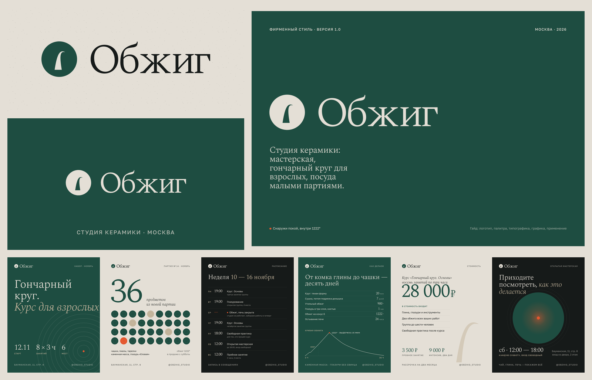
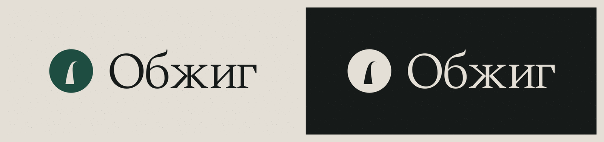
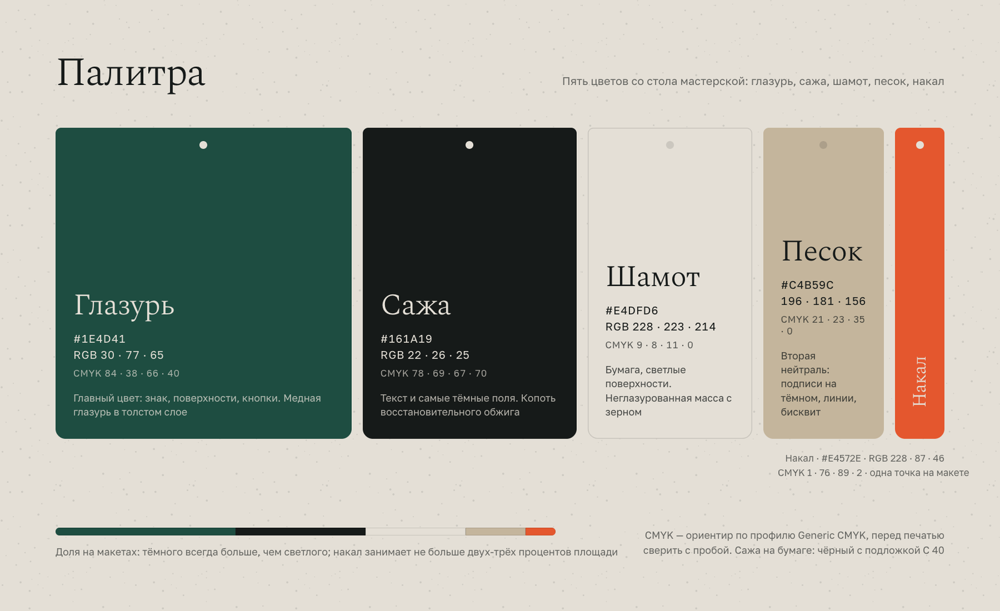
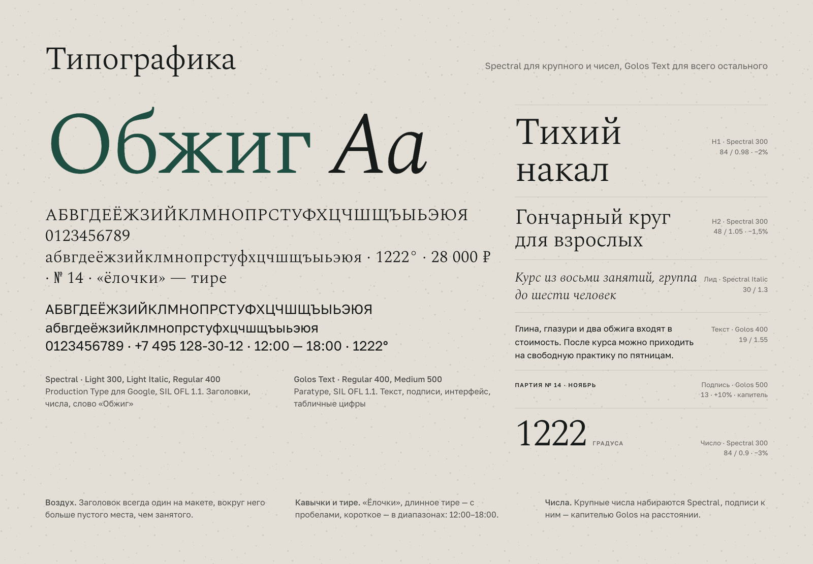
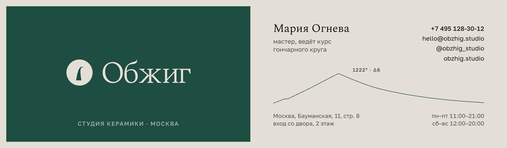
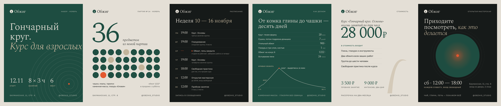
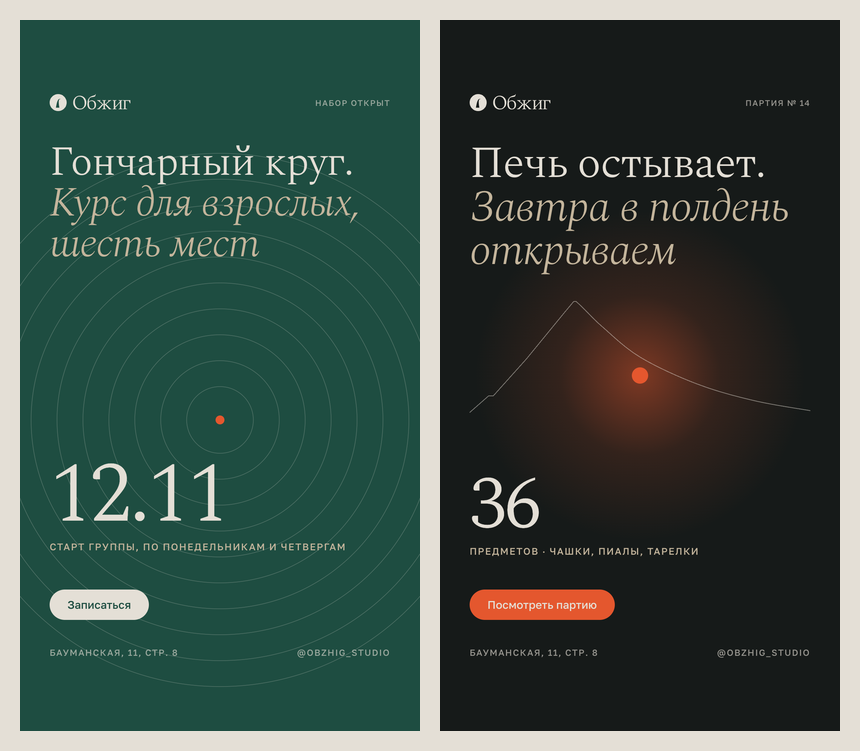
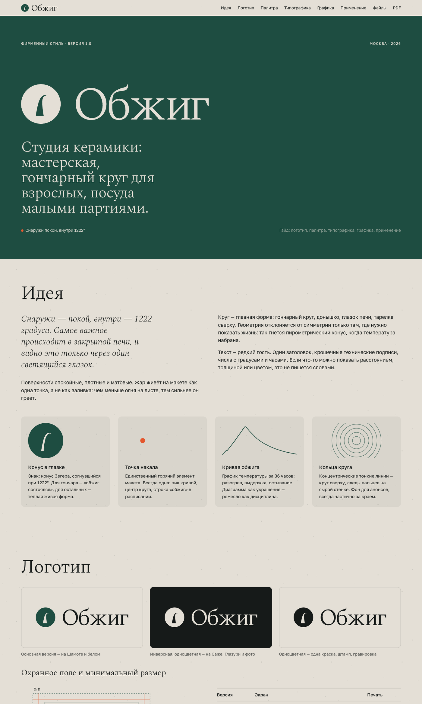

# Обжиг — фирменный стиль студии керамики

Полный комплект айдентики для студии керамики в Москве: знак и логотип, палитра, типографика, визитка, посты и сторис, онлайн-гайд с PDF. Всё нарисовано кодом (SVG, HTML/CSS) и собирается одной командой.

Демо для портфолио: компания вымышленная, цены, даты, адрес и контакты на макетах — примеры.

Онлайн-гайд: https://malishq.github.io/brand-identity-ceramics/



## Что сделано

- **Философия стиля** — `philosophy.md`: движение «Тихий накал» и то, как оно переходит в систему (знак, точка накала, кривая обжига).
- **Логотип** — `logo/`: знак «конус в глазке печи» (пирометрический конус Зегера, согнувшийся при 1222°), слово «Обжиг» в кривых (Spectral Light), версии цветная, инверсная и одноцветная, знак отдельно, PNG на светлом и тёмном, правила охранного поля и минимальных размеров в `logo/README.md`. SVG — чистые кривые без растров и шрифтов.
- **Палитра** — `palette.md`, `palette.png`: пять цветов с HEX, RGB, ориентиром CMYK и ролями. Не «крем + терракота»: тёмно-зелёная глазурь, сажа, серо-песочный шамот, песок и одна точка накала. Обоснование — в философии.
- **Типографика** — `typography.md`, `typography.png`: Spectral (заголовки, числа) + Golos Text (текст, подписи), шесть уровней иерархии, правила набора.
- **Визитка 90 × 50 мм** — `cards/`: лицо и оборот PNG 300 dpi (1063 × 591) и `business-card.pdf` с двумя страницами точного размера (векторный текст).
- **Соцсети** — `social/`: шесть постов 1080 × 1350 (анонс курса, новая партия, расписание недели, процесс, стоимость, приглашение) и две сторис 1080 × 1920.
- **Гайд** — `brandbook/index.html`: одностраничный брендбук с относительными путями, печатается в `brandbook/brandbook.pdf` (A4 альбомный, 9 страниц). Копия для GitHub Pages — `site/`.
- **Превью** — `docs/screens/`: коллаж и по одному превью на тип.

## Стек

- Макеты: HTML/CSS, Google Fonts (Spectral, Golos Text) с кириллицей.
- Рендер: Python 3.9, Playwright + Google Chrome (`page.screenshot`, `page.pdf`), Pillow для превью, pypdf для точного размера страниц PDF.
- Логотип: NumPy (параметрический конус) + fontTools (глифы в кривые), `scripts/make_logo.py`.

## Скриншоты

| | |
|---|---|
|  |  |
|  |  |
|  |  |



## Запуск

```bash
~/Desktop/Учёба/.venv/bin/pip install -r requirements.txt
~/Desktop/Учёба/.venv/bin/python scripts/make_logo.py
~/Desktop/Учёба/.venv/bin/python scripts/render.py
```

`render.py` без аргументов собирает всё: визитку, соцсети, палитру, типографику, PNG логотипа и PDF гайда. Можно по частям: `render.py cards`, `social`, `sheets`, `brandbook`. Превью в `docs/screens/` — `scripts/assets.py` (ассеты гайда) и `scripts/screens.py`. Нужен установленный Google Chrome и доступ к Google Fonts при рендере.

Деплой гайда на GitHub Pages: `scripts/deploy.sh` копирует `brandbook/` в `site/` и пушит её как ветку `gh-pages`.

## Как адаптировать под клиента

- **Название и слово в логотипе** — `WORD` в `scripts/make_logo.py`, затем `make_logo.py`. Форма конуса — параметры `cone_path()` там же.
- **Цвета** — `src/tokens.css` (переменные), `palette.md`, блок палитры в `brandbook/index.html`.
- **Тексты, цены, даты, контакты** — HTML в `src/cards/`, `src/social/`, `src/sheets/`; после правок `scripts/render.py`.
- **Имя мастера, телефон, адрес** на визитке — `src/cards/card.html`.
- **Гайд** — `brandbook/index.html`; картинки применений в `brandbook/assets/` обновляет `scripts/assets.py`.

## Примерные данные

Студия «Обжиг», мастер Мария Огнева, адрес, телефон, почта, домен obzhig.studio, цены (28 000 ₽ за курс, 3 500 ₽ пробное, 9 000 ₽ интенсив), даты и расписание — вымышленные образцы, их нужно заменить на данные клиента.

## Шрифты и лицензии

- Spectral — Production Type для Google Fonts, SIL Open Font License 1.1.
- Golos Text — Paratype, SIL Open Font License 1.1.

Оба шрифта подключаются через Google Fonts; для логотипа глифы Spectral Light переведены в кривые. Картинок и чужих материалов в проекте нет: вся графика нарисована кодом.
